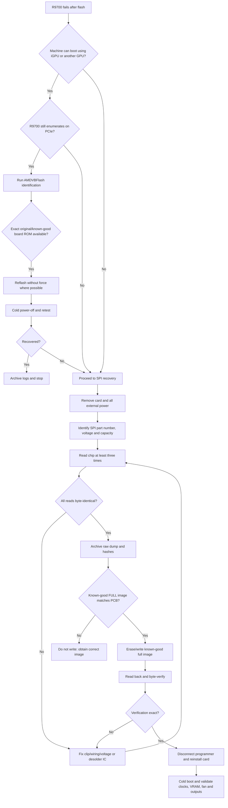

# Radeon AI PRO R9700 VBIOS Development, Modification and Recovery

## Executive summary and scope

This report treats **“Radeon R9700” as the modern AMD Radeon AI PRO R9700 / R9700S, introduced in 2025**, not the ATI Radeon 9700/9700 Pro family from 2002. The modern R9700 is an RDNA 4 workstation/AI accelerator with 64 compute units, 4,096 stream processors, 128 AI accelerators, 32 GB of GDDR6 on a 256-bit interface, 20 Gbit/s memory, 640 GB/s peak memory bandwidth, PCIe 5.0 x16 and a nominal 300 W board-power class. AMD specifies a game clock of 2,350 MHz and boost of up to 2,920 MHz; the product uses a single 12V-2x6 auxiliary power connector. citeturn22search0turn9view2

The most important conclusion is that **R9700 VBIOS modding should currently be approached as firmware reverse-engineering rather than as a mature “BIOS editor” ecosystem**. AMD's firmware remains ATOM-based and exposes versioned data structures for information such as VRAM configuration and board policy, but the RDNA 4 generation delegates substantial power, voltage, clock and thermal management to the SMU/firmware stack. AMD's open-source kernel work demonstrates that ATOM firmware tables are explicitly revisioned and continue evolving; offsets from older Radeon generations should therefore never be transplanted blindly. citeturn21search4

There is nevertheless useful evidence that R9700 VBIOS updates can alter board policy. ASUS released an official **TURBO-AI-PRO-R9700-32G BIOS Update Tool v1 on 4 June 2026 specifically to refine the fan curve**, with package SHA-256 `CD499DBF1079B2E65666FF66877C367B4823BBE15910446AB1A2A72C7224B0A0`. ASUS subsequently fixed R9700 fan-curve manipulation in GPU Tweak III and made changes to its voltage/frequency tuning UI. That establishes that cooling and at least some performance policy are adjustable, but it does **not** establish that an arbitrary modified ROM will be accepted by every R9700 board, driver and firmware revision. citeturn23view0turn23view1

A stock firmware identifier repeatedly observed in field logs is:

```text
ATOM BIOS: 113-EXT119250-100
Build:     00158753
VBIOS:     023.008.000.068.000001
Date:      2025/07/25
PCI GPU:   1002:7551
```

The same `023.008.000.068.000001` identifier has been reported on ASRock-built R9700 cards and on Sapphire boards. That is strong evidence of a common AMD firmware baseline across several early cards, but **it is not evidence that their complete ROM images are byte-for-byte interchangeable**: subsystem IDs, display routing, GPIOs, fan configuration, memory population and board-power implementation may still differ. For example, GIGABYTE's card exposes three DisplayPort 2.1a plus one HDMI 2.1b whereas Sapphire, XFX and several other designs expose four DisplayPorts, making cross-flashing particularly unsafe. citeturn22search13turn12search8turn19view5turn19view0turn23view3

A second important finding is negative but safety-critical: **I could not find a vendor schematic, BOM, boardview or sufficiently documented naked-PCB teardown that establishes the exact SPI-NOR manufacturer/part number and VRM-controller part number for each retail R9700 board**. Alphacool reported in November 2025 that the R9700 had an AMD PCB layout but that it did not yet have the board information/sample needed even to develop a cooler. Official AIB documentation generally describes cooler and component classes, not the individual PWM controller, DrMOS or SPI-NOR markings. citeturn22search16turn17view0

Consequently, **do not buy a programmer adapter on the assumption that the R9700 BIOS is a particular 3.3 V or 1.8 V Winbond/Macronix/GigaDevice device**. Remove the cooler/backplate if necessary, read the top marking, identify the precise datasheet and voltage, and only then connect a programmer. This report provides the standard eight-pin serial-NOR wiring because it is useful once the actual chip has been identified; it deliberately does not manufacture an R9700-specific flash-chip part number that has not been publicly verified.

The safest modification hierarchy is therefore:

**runtime tuning → official vendor VBIOS → experimentally modified VBIOS with proven recovery → raw SPI recovery**.

For core/memory clocks, voltage and fan curves, software tuning is preferable because failed settings disappear after reset and preserve the factory firmware. Direct VBIOS editing becomes justified mainly for research, persistent board-policy changes, repairing corrupted firmware, or functionality that cannot be expressed through the driver.

## Board partners, models and hardware implementation

I could verify retail or vendor-documented R9700-family cards from **ASUS, ASRock, GIGABYTE, PowerColor, Sapphire and XFX**. The R9700S passive derivative is additionally documented by AMD and by partners including ASRock, Sapphire and PowerColor. This is a list of models verified during this research, not a claim that no regional/OEM rebrand exists anywhere. citeturn15search3turn17view2turn17view3turn20search5

AMD itself publishes the R9700 specifications, but the apparent AMD reference-style card should not be treated as a normal retail reference board. A reference-looking engineering sample has surfaced, marked as an engineering/non-resale unit; the mainstream retail market consists of partner implementations. citeturn22news28turn22search0

### Verified model matrix

| Manufacturer / model | GPU and clocks | VRAM | Cooling / PCB distinctions | VBIOS evidence | Exact SPI / VRM evidence | Preferred recovery route |
|---|---|---|---|---|---|---|
| **ASUS TURBO-AI-PRO-R9700-32G** | RDNA 4 R9700; reference-class 2,350 MHz game / up to 2,920 MHz boost | 32 GB GDDR6, 256-bit, 20 Gbit/s class | Two-slot blower-oriented professional card. ASUS maintains GPU Tweak III specifically for it. | **Official BIOS Update Tool v1, 2026-06-04**, fan-curve revision; package SHA-256 known. citeturn23view0 | No public controller/flash-chip BOM found. | First use ASUS/AMDVBFlash path; retain SPI programmer as recovery. |
| **ASRock Radeon AI PRO R9700 Creator 32GB**, model `R9700 CT 32G` | 2,350 / 2,920 MHz | 32 GB GDDR6, 256-bit, 20 Gbit/s | Two-slot blower; high-density PCB / “Super Alloy” component marketing; metal construction and workstation cooling. citeturn14search1turn20search5 | Field report: `023.008.000.068.000001`; subsystem observed as `1849:5413`. citeturn22search13 | No verified SPI or PWM-controller top marking found. | AMDVBFlash while card enumerates; otherwise external SPI. |
| **ASRock Radeon AI PRO R9700S Passive 32GB**, `R9700S PS 32G` | 2,350 / 2,920 MHz | 32 GB GDDR6, 256-bit, 20 Gbit/s | 190 × 112 × 38 mm, two slots; passive vapour chamber, metal shroud/backplate, Honeywell PTM7950; business-channel model; 12V-2x6. citeturn17view3 | Treat as a separate board/policy family from active R9700. | Undisclosed. | SPI backup especially important; **never assume active-card fan BIOS is compatible**. |
| **GIGABYTE Radeon AI PRO R9700 AI TOP 32G**, `GV-R9700AI TOP-32GD`, revisions 1.0 and 1.1 | 2,350 / 2,920 MHz | 32 GB, 20 Gbit/s, 256-bit, 640 GB/s | Turbo blower, vapour chamber, all-copper heat sink, metal frame; **3× DP 2.1a + 1× HDMI 2.1b**. citeturn17view0turn19view5 | Support site contains a BIOS category but, at the time researched, displayed no downloadable BIOS entry. citeturn19view6 | No public SPI/VRM-controller identification found. Rev. 1.0 vs 1.1 makes board revision matching important. | Dump exact revision before modification; software reflash first, SPI second. |
| **PowerColor Radeon AI PRO R9700 32G-B** | 2,350 / 2,920 MHz class | 32 GB GDDR6, 20 Gbit/s, 256-bit | Two-slot professional/blower class; 4-DP retail listings. citeturn20search5 | No public per-ROM checksum verified in this research. | Undisclosed. | AMDVBFlash if recognised; external programmer for brick recovery. |
| **PowerColor Radeon AI PRO R9700S** | R9700S reference specification | 32 GB GDDR6 | Passive/server-oriented R9700S implementation documented by PowerColor. citeturn15search31 | No public dump verified here. | Undisclosed. | Full original dump before any experiment. |
| **Sapphire AMD Radeon AI PRO R9700 32GB**, SKU **32358-01** | 2,350 / 2,920 MHz | 32 GB GDDR6, 256-bit, 20 Gbit/s; 640 GB/s | Active two-ball-bearing blower, two-slot, 266.7 × 111 × 39 mm, 12V-2x6, 300 W, 4× DP 2.1a. citeturn19view0turn19view1turn19view3 | Field evidence shows stock `023.008.000.068.000001` on Sapphire R9700 hardware. citeturn12search8 | Undisclosed. | Software backup/reflash, then external SPI. |
| **Sapphire AMD Radeon AI PRO R9700S 32GB Passive**, SKU **32361-01** | 2,350 / 2,920 MHz | 32 GB GDDR6, 256-bit, 20 Gbit/s | Passive, four DP 2.1a, PCIe 5.0 x16. citeturn17view2 | Keep separate from 32358-01 active firmware even where core versions match. | Undisclosed. | External recovery capability recommended before experimentation. |
| **XFX AMD Radeon AI PRO R9700**, `RX-97XPROAIY` | XFX lists approximately 1,620 MHz base, 2,350 MHz game, 2,920 MHz boost | 32 GB GDDR6, 20 Gbit/s, 256-bit, 640 GB/s | Two-slot blower, 4× DP 2.1a, 12V-2x6; XFX documents its own cooler/fan implementation. citeturn23view3 | No verified public R9700 XFX ROM checksum found in this research. | Undisclosed. | AMDVBFlash first; programmer for recovery. |

The common memory specification gives the advertised bandwidth directly:

\[
20\ {\rm Gbit/s} \times 256\ {\rm bits} / 8 = 640\ {\rm GB/s}.
\]

GIGABYTE and Sapphire both publish that 640 GB/s figure. citeturn19view5turn19view0

The underlying GPU is commonly identified as **Navi 48 / RDNA 4**, with field logs exposing AMD PCI device ID **`1002:7551`**. An ASRock-built board has been observed as `1002:7551 / 1849:5413`; however, the exact silicon stepping such as A0/A1 is not published in the retail specifications reviewed here. Thus a VBIOS-development database should record the PCI revision register from each physical sample rather than infer a stepping merely from “R9700”. citeturn22search13turn22news31

**Memory-vendor details are similarly under-documented.** Vendors publish 32 GB GDDR6, 20 Gbit/s and a 256-bit aggregate bus, but not whether a particular production batch uses Samsung, SK hynix or Micron devices. A 32 GB implementation on this width may require a different package organisation/population from the 16 GB RX 9070-class boards, so any memory-strap experiment should begin by recording every DRAM top marking on the actual PCB rather than assuming the straps of a related Navi 48 card apply. The official R9700 specifications establish capacity, width and data rate, but not the DRAM BOM. citeturn22search0turn19view0

The same restriction applies more strongly to **VRM topology**. ASRock advertises its “Super Alloy” board construction and GIGABYTE advertises durable components, vapour-chamber/all-copper cooling and a metal frame, but neither source identifies the PWM controller, individual power stages or verified GPU/SoC/GDDR6 phase count. citeturn17view0turn17view3 A safe engineering database should therefore use fields such as:

```text
Board vendor/revision:
PCB silkscreen:
PCI subsystem vendor/device:
GPU PCI revision:
VBIOS version/string:
VBIOS SHA-256:
GPU VRM PWM controller:
GPU power-stage marking:
VRAM VRM controller:
GPU phase count:
SoC phase count:
Memory phase count:
SPI-NOR top marking:
SPI-NOR JEDEC ID:
SPI-NOR voltage:
SPI-NOR size:
DRAM manufacturer / top marking:
Display connector map:
Fan connector / tach configuration:
```

Do not fill an unknown field by copying an RX 9070 XT database entry merely because both boards are Navi 48.

## VBIOS architecture, known revisions and development strategy

The R9700 firmware should be treated as several nested layers rather than “a table of clocks”. AMD's ATOM firmware format exposes revisioned information tables; Linux amdgpu development explicitly carries different `vram_info` table revisions, illustrating why a parser must read the structure header and revision rather than assume old offsets. citeturn21search4

For a reverse-engineering project, the useful conceptual structure is:

```text
SPI NOR
└── AMD graphics firmware / option-ROM image
    ├── PCI option-ROM headers
    │   ├── 0x55 AA signature
    │   ├── PCIR structures
    │   └── legacy and/or EFI image metadata
    │
    ├── AMD ATOM firmware
    │   ├── ROM / master table headers
    │   ├── FirmwareInfo
    │   ├── VRAM_Info
    │   ├── GPIO / board information
    │   ├── Display object / connector information
    │   ├── voltage information
    │   └── PowerPlay / SMU-related information
    │
    ├── UEFI GOP portions
    └── opaque / firmware-controlled regions
```

The exact table set and revision should be extracted from the target ROM. A traditional AMD ATOM parser may use the ROM's pointer structures to reach the ATOM header and master data table, but **development code should validate signatures, lengths and table revisions before every dereference**. An offset that happens to represent a frequency in one ROM can represent unrelated data after a table revision.

### Known R9700 firmware identifiers

The strongest public field evidence for the common launch-era image is:

| Field | Observed value | Confidence |
|---|---|---|
| VBIOS version | `023.008.000.068.000001` | High; independently seen in R9700 systems, including ASRock-built hardware. citeturn22search13 |
| ATOM BIOS identifier | `113-EXT119250-100` | Community diagnostic output. |
| Build | `00158753` | Community diagnostic output. |
| Date | `2025/07/25` | Community diagnostic output. |
| GPU PCI ID | `1002:7551` | High from field enumeration. citeturn22search13 |
| ASUS update | `v1`, dated `2026/06/04` | Official ASUS release. citeturn23view0 |
| ASUS package filename | `AI-PRO-R9700.zip` | Official. citeturn23view0 |
| ASUS package size | 12,582,014 bytes | Official. citeturn23view0 |
| ASUS **package** SHA-256 | `CD499DBF1079B2E65666FF66877C367B4823BBE15910446AB1A2A72C7224B0A0` | Official. This is **not proven to be the embedded ROM's hash**. citeturn23view0 |
| GIGABYTE publicly downloadable BIOS | None shown on support page at research date | Official support page's BIOS category was empty. citeturn19view6 |

That distinction between **package checksum** and **ROM checksum** matters. A ZIP may contain the flasher, scripts, several board-specific ROMs, configuration files or updater metadata. Never put an update package, executable or partial update payload directly into an SPI programmer.

This is a general firmware-recovery trap documented repeatedly in BIOS-modding practice: update packages can contain only the region expected by a vendor updater rather than a complete physical SPI image; writing such a partial payload as if it were the whole chip can brick the device. citeturn21search29

For every physical R9700 in a lab, create your own canonical hashes:

```bash
sha256sum r9700-original.rom
sha512sum r9700-original.rom
```

On Windows PowerShell:

```powershell
Get-FileHash .\r9700-original.rom -Algorithm SHA256
Get-FileHash .\r9700-original.rom -Algorithm SHA512
```

Keep the original read-only, and derive every experimental image from a copy.

### Does each manufacturer's BIOS differ?

**The correct answer is “potentially yes, even when the visible AMD version string is identical”.**

There are at least four independent reasons.

First, the common `023.008.000.068.000001` string appearing on different partners shows that AMD supplied a common firmware baseline. citeturn22search13turn12search8

Second, connector topology is not universal. GIGABYTE uses three DisplayPorts plus HDMI, while Sapphire and XFX document four DisplayPorts. That requires board-specific display routing somewhere in the overall hardware/firmware configuration and makes blind cross-flashing unjustifiable. citeturn19view5turn19view0turn23view3

Third, ASUS has released an explicitly **ASUS-model-specific firmware revision whose purpose is a different fan curve**. Thus two ROMs can target the same AMD silicon and nominal clocks while containing materially different board policy. citeturn23view0

Fourth, active R9700 and passive R9700S products necessarily have different cooling assumptions. ASRock and Sapphire explicitly document passive R9700S designs. A blower BIOS that expects a controllable tach/PWM fan is therefore not an acceptable “similar” image for a passive board. citeturn17view2turn17view3

Accordingly, a cross-flash should be considered compatible only after comparing at least the PCB revision, subsystem ID, output topology, memory population, VRM implementation, thermal sensors, cooling implementation and ROM table contents. Matching `023.008.000.068.000001` alone is insufficient.

I did not obtain a verifiable TechPowerUp R9700 per-ROM record carrying a complete dump hash during this research. It would therefore be misleading to manufacture MD5/SHA values for individual ASUS/ASRock/GIGABYTE/PowerColor/Sapphire/XFX ROMs. Treat any repository ROM as a **candidate recovery image**, not as ground truth, until its board ID and binary structure have been compared with your own dump.

## SPI-NOR, board identification and programmer wiring

### What is actually known about the R9700 flash device

The R9700 documentation reviewed here does **not** expose a per-model serial-NOR part number. Likewise, I found no sufficiently documented naked-board teardown establishing, for example, “all R9700 Creator cards use Winbond part X”. Alphacool's difficulty obtaining enough PCB information even for cooler development reinforces how little board-level documentation existed publicly. citeturn22search16

Therefore the safe answer to “which flash chip does my R9700 use?” is:

> **Read the top marking on your exact board, then obtain the datasheet for that exact suffix.**

Contemporary PC firmware commonly uses JEDEC 25-series serial NOR in SOIC/SOP-8 or WSON-8 packages, and markings beginning with families such as `W25...`, `MX25...`, `GD25...`, `IS25...` and similar are common enough that a technician should recognise them. **Those families are diagnostic candidates, not a claim that a particular one is fitted to every R9700.**

Suffixes are critical because devices in superficially similar families may use different supply voltages. Never infer voltage from “eight pins”, package colour or a partial family number.

### Standard serial-NOR pinout

For the common eight-pin SPI/QSPI NOR arrangement, viewed from the top:

```text
                   .------\/------.
       /CS   pin 1 | •          8 | pin 8   VCC
  DO / IO1   pin 2 |            7 | pin 7   /HOLD, /RESET or IO3
 /WP / IO2   pin 3 |            6 | pin 6   CLK
       GND   pin 4 |            5 | pin 5   DI / IO0
                   '--------------'
```

The dot/notch identifies **pin 1**. On a SOIC clip, the red stripe conventionally corresponds to the pin-1 conductor, but verify continuity on the actual harness rather than trusting colour coding.

A generic programmer connection is:

```text
Flash IC                     SPI programmer
--------                     --------------
1  /CS        -------------- CS
2  DO / IO1   -------------- MISO / DO
3  /WP / IO2  -------------- WP / pulled high as required
4  GND        -------------- GND
5  DI / IO0   -------------- MOSI / DI
6  CLK        -------------- CLK
7  HOLD/IO3   -------------- HOLD / pulled high as required
8  VCC        -------------- EXACT device supply voltage
```

This is a **logical SPI-NOR diagram, not an assertion about the voltage of the R9700's unknown device**.

### Where to look on the PCB

Because a verified bare-board R9700 map is unavailable, the following should be treated as a **search diagram**, not a component-location claim:

```text
           Display bracket                                  Aux power
       ┌─────────────────────────────────────────────────────────────┐
       │ DP/HDMI       GPU + GDDR6                 VRM       12V-2x6│
       │ [ports]       ┌──────────┐             [phases]      [conn]│
       │               │   GPU    │                            │    │
       │        [VRAM] │ Navi 48  │ [VRAM]                     │    │
       │               └──────────┘                            │    │
       │                                                       │    │
       │   Search both sides for a small 8-pin/WSON serial-NOR IC  │
       │   with a 25-series-style marking.                         │
       └──────────── PCIe 5.0 x16 edge connector ──────────────────┘
```

Useful identification criteria are the manufacturer's logo/top code, package pin-1 mark, nearby small decoupling capacitor, and trace relationship to the GPU. **Do not identify a chip as the VBIOS merely because it has eight pins**; fan controllers, EEPROMs and other serial devices can use similar packages.

Before attaching any programmer:

1. disconnect the computer PSU from mains;
2. disconnect the 12V-2x6 cable;
3. remove the card from the PCIe slot where practical;
4. discharge the board and verify the relevant rail is no longer powered;
5. identify the flash part and supply voltage from its datasheet;
6. measure the programmer's VCC with a multimeter **before** attaching the clip;
7. never power the GPU normally while an ordinary external programmer is also driving its SPI supply/lines unless the board and programmer are specifically designed for that arrangement.

### Recommended programmers

For valuable R9700 hardware, the hierarchy I would use is:

| Programmer | Suitability | Why |
|---|---|---|
| **Dediprog SF-series or equivalent professional SPI programmer** | **Preferred lab solution** | Designed specifically around serial flash work, better electrical control and repeatability than bargain programmers; useful when in-circuit conditions are difficult. |
| **XGecu T48/T56-class universal programmer** | **Very good when the IC can be removed or connected through a correct adapter** | Broad device database, useful sockets/adapters and controlled programming; excellent for desoldered recovery. |
| **CH341A + known-good SOIC clip + correct voltage adapter** | **Good inexpensive recovery tool, with caution** | Widely used with flashrom and well documented by the BIOS-modding community, but clone-board electrical behaviour and adapter quality vary. citeturn21search1 |
| **Raspberry Pi / other SBC using SPI + flashrom-compatible interface** | Useful for an experienced electronics user | Flexible but requires correct voltage, wiring and usually more attention to level compatibility and bus contention. |
| **“Hot flash” using another graphics card** | **Not recommended for R9700** | Requires live hardware manipulation, exact electrical compatibility and often physically removable flash. External programming is materially safer. |

Flashrom supports workflows in which the programmer probes the JEDEC device, reads, writes and verifies it. Its diagnostic output can also expose protection state; examples show flashrom reporting block-protection bits and write-protect status. citeturn21search17 The long-running Win-Raid/Level1Techs CH341A guide remains useful for the practical clip/programmer workflow. citeturn21search1

### In-circuit versus removed-chip programming

Start with a clip only when the flash package is accessible. Read the chip **at least three times**. Hash every read:

```bash
flashrom -p ch341a_spi -r r9700-read1.bin
flashrom -p ch341a_spi -r r9700-read2.bin
flashrom -p ch341a_spi -r r9700-read3.bin

sha256sum r9700-read*.bin
cmp r9700-read1.bin r9700-read2.bin
cmp r9700-read1.bin r9700-read3.bin
```

All three should be byte-identical.

If they are not, **do not write anything**. The likely problem is not “three corrupt BIOSes”; it is an electrically unreliable in-circuit read — bus loading, another component holding a line, insufficient current, wrong voltage or a poor clip connection. At that point, improve the connection or desolder the IC and read it in a socket.

Never proceed from:

```text
read #1 = hash A
read #2 = hash B
read #3 = hash C
```

to a write operation.

Proceed only from:

```text
read #1 = hash A
read #2 = hash A
read #3 = hash A
device ID and file size are plausible
original image is archived elsewhere
```

## Modification targets, expected benefit and risk

The distinction that matters most on the R9700 is **runtime policy modification versus persistent firmware modification**. ASUS's own software history illustrates that fan curves and voltage/frequency controls exist at runtime: GPU Tweak III v2.1.6.0 fixed R9700 fan-curve adjustment, while v2.1.4.0 corrected a voltage-frequency tuner boundary issue. citeturn23view0turn23view1

That makes software tuning the correct experimental tool for finding a stable target. A VBIOS should not be used as the first place to discover whether, say, a memory overclock is stable.

| Target | Potential benefit | Recommended approach | Firmware-mod risk | Assessment |
|---|---|---|---|---|
| **Fan curve** | Lower noise, different thermal/noise balance | Vendor BIOS update or runtime fan control first | Medium | **Most defensible persistent modification**, because ASUS officially changed it in VBIOS. However, preserve VRAM/VRM airflow and minimum blower speed. citeturn23view0 |
| **Core clock limits** | More performance or reduced consumption | Runtime driver/utility testing | High as ROM edit | SMU/boost logic ultimately determines realised clocks. A literal frequency-table change may not behave as an old Radeon BIOS would. |
| **GPU undervolt** | Lower power/noise/temperature | Runtime V/F curve first | Medium–high in VBIOS | Potentially beneficial; validate long compute workloads and low-power state transitions, not merely a benchmark. ASUS exposes V/F tuning in software. citeturn23view1 |
| **GPU overvoltage** | Potential clock headroom | Avoid for normal use | **Very high** | Raises GPU and VRM stress; unknown VRM controller/phase margin makes persistent overvoltage especially poorly justified. |
| **GDDR6 frequency** | More bandwidth | Runtime testing, if driver exposes it | High | Memory instability can produce computation errors, not merely a visible crash. |
| **GDDR6 timings / straps** | Potential latency/bandwidth improvement | Research only | **Very high** | Exact memory vendor/population is not publicly fixed across all boards; importing straps from RX 9070-class cards is unsafe. |
| **Power limit** | Sustained clocks under heavy AI/compute loads | Stay inside driver/vendor-exposed range | High to very high in ROM | Card is specified around 300 W and a 12V-2x6 input; a higher firmware limit also changes VRM, connector and cooler loading. citeturn19view3turn22search0 |
| **Thermal limits** | Higher boost before throttling | Usually leave stock | Very high | Defeats a safety mechanism and may expose VRAM/VRM components to conditions not represented by GPU temperature. |
| **Fan-stop / 0-RPM** | Lower idle noise | Only through tested runtime/vendor implementation | High on blower cards | A blower can cool VRM/VRAM even when the GPU itself is cool; forcing fan stop without component-temperature measurements is poor practice. |
| **VRAM_Info** | Necessary for memory-hardware engineering | Read-only parsing first | Extreme | Wrong density, width, vendor timing or training data can prevent display/initialisation. ATOM VRAM structures are revisioned. citeturn21search4 |
| **GPIO / fan mappings** | Board conversion/research | Only with schematic/continuity work | Extreme | Wrong GPIO programming can break fan control or peripheral power sequencing. |
| **DisplayObject / connector tables** | Fix custom/output hardware | Normally leave untouched | High | Especially board-specific; GIGABYTE's HDMI/DP layout differs from four-DP boards. citeturn19view5turn19view0 |
| **PCI subsystem IDs** | Little practical performance benefit | Do not change for tuning | High compatibility risk | Can make drivers/vendor flash tools misidentify the board. |
| **UEFI GOP** | Compatibility fixes only | Replace only with understood, matching component | High | No performance gain; corruption can eliminate pre-OS display. |

### Core and memory overclocking

The R9700's official 2,350 MHz “game” and 2,920 MHz “boost” figures are policy points, not a guarantee that every workload runs at either frequency. AMD explicitly notes that achieved boost depends on thermal conditions and workload. citeturn17view2turn19view0

For AI/HPC use, stability criteria also differ from gaming. An overclock that completes a graphics benchmark but occasionally corrupts a tensor operation is not useful. The validation suite should therefore include sustained compute, large VRAM allocations, memory-copy tests, repeated cold boots, idle-to-full-load transitions and multi-hour workload runs.

Memory tuning deserves special caution because the R9700 is attractive precisely for its 32 GB capacity. A one-per-cent performance benefit is not worthwhile if marginal timings cause silent model-output corruption or occasional GPU resets.

AMD lists ECC support for the R9700 in supported environments, including Linux-related support distinctions, but ECC capability should not be interpreted as a licence to use unstable memory timings. citeturn9view2

### Voltage and power tables

A traditional BIOS-modding mindset is to find a voltage table, raise a value and recalculate the checksum. That is increasingly inadequate on current Radeon hardware because the SMU participates in voltage/frequency/power management. The useful development task is therefore to determine:

```text
Which value is descriptive?
Which value is a hard board limit?
Which value is an SMU policy request?
Which value is fused?
Which value does the driver override?
Which value is checked against another table?
```

Changing only one representation can have no effect, cause clipping at a different limit, or create an inconsistent policy.

Since no verified per-model VRM controller/phase map is publicly available, **overvolting is the least defensible R9700 BIOS modification**. Conversely, a modest undervolt discovered and extensively validated through runtime control can be useful for dense multi-GPU systems because it can reduce heat and acoustic load without requiring a permanent ROM change.

### Fan tables

This is the one modification class for which there is incontrovertible R9700 vendor evidence: ASUS changed the VBIOS specifically for acoustics. citeturn23view0

Even here, the development process should compare the old and new official ASUS ROMs before attempting any custom edit. A binary diff of two vendor-signed/accepted versions can reveal:

```text
unchanged header regions
changed thermal/fan tables
changed checksums
possibly changed version metadata
unexpected additional firmware changes
```

That differential analysis is far safer than guessing a fan table from an RDNA 2/3 editor.

### Legacy Radeon BIOS editors

Tools designed around Polaris, Vega, Navi 10/20/21 or older “memory strap” layouts should **not be assumed R9700-safe**. I found no authoritative evidence during this research that classic Radeon BIOS Editor/Red BIOS Editor/MorePowerTool-style workflows can safely regenerate a complete RDNA 4 R9700 ROM for persistent flashing.

They can still be useful as reverse-engineering references, but “the program opens the file” is not evidence that it understands every RDNA 4 table revision or preserves opaque/signed regions.

## Software flashing, protections and brick recovery

### Software-level dump and flash

The best-supported concrete R9700 example is the ASUS update workflow. A Linux R9700 user documenting the ASUS card reported that the vendor package uses `amdvbflash.exe` and demonstrated the familiar operations of enumerating adapters, saving a BIOS and programming one. Treat this as community evidence and verify the exact syntax with the executable's own help because AMDVBFlash versions differ. citeturn23view2

Typical commands are:

```text
amdvbflash -i
```

to enumerate adapters, then:

```text
amdvbflash -s 0 r9700-original.rom
```

to save adapter 0, followed—only after validating the target—with:

```text
amdvbflash -p 0 known-good-r9700.rom
```

The ASUS BIOS updater is Windows-oriented; ASUS lists Windows 10/11 utilities for this card. citeturn23view0 A Linux AMDVBFlash build may exist independently, but version parity and RDNA 4 support must not be assumed simply because an older Linux build recognises older Radeon cards.

On an operating system where the GPU is not the boot display, using an iGPU or secondary GPU greatly improves recovery prospects because the failed R9700 need only remain visible enough on PCIe for the flasher to address it.

Before any write, record:

```text
adapter number
PCI bus:device:function
PCI vendor/device ID
PCI subsystem ID
board serial number
VBIOS string
VBIOS SHA-256
file size
display connector arrangement
PCB revision / silkscreen
```

This matters particularly in multi-R9700 machines: flashing “adapter 0” without first correlating the index to a PCIe slot is an avoidable way to destroy the good card.

### Raw flashrom workflow

Once the exact SPI device and voltage are known, a generic CH341A workflow is:

```bash
# Identify / probe
flashrom -p ch341a_spi

# Optional, where supported
flashrom -p ch341a_spi --wp-status

# Multiple reads
flashrom -p ch341a_spi -r read1.bin
flashrom -p ch341a_spi -r read2.bin
flashrom -p ch341a_spi -r read3.bin

# Verify reproducibility
sha256sum read1.bin read2.bin read3.bin
cmp read1.bin read2.bin
cmp read1.bin read3.bin
```

Flashrom outputs can expose status-register block-protection state, including BP bits and whether protection is enabled. citeturn21search17

Only after three identical reads and confirmation that the intended write file represents a **complete image appropriate to the physical chip**:

```bash
flashrom -p ch341a_spi -w known-good-full-image.bin
```

and independently:

```bash
flashrom -p ch341a_spi -v known-good-full-image.bin
```

For a supported Dediprog backend the analogous syntax is generally based on the `dediprog` programmer selection; verify against the installed flashrom version rather than copying an old command blindly.

### Checksums and signatures

Several distinct concepts are frequently conflated.

**Package checksum.** ASUS provides the SHA-256 of its downloadable ZIP. This proves the ZIP's integrity against ASUS's published value; it says nothing directly about an extracted ROM's byte checksum. citeturn23view0

**PCI option-ROM checksum.** Traditional option-ROM images carry ordinary structural checksums. A modding tool may need to update these when bytes are changed.

**ATOM structure integrity.** Tables have explicit lengths/revisions and may include integrity fields. A structurally valid outer option-ROM checksum does not prove every ATOM table is internally valid.

**Flash hardware protection.** Serial-NOR devices can expose status-register block-protection states, and `/WP` may participate in hardware write protection. Flashrom can report such state for supported devices. citeturn21search17

**Vendor/AMD authentication.** I did **not** find public evidence establishing that the entire R9700 SPI image uses one simple whole-ROM cryptographic signature for which a community “resigner” exists. Conversely, it would be equally unsafe to conclude that arbitrary modifications are accepted simply because the classic option-ROM checksum can be repaired. Modern AMD firmware contains multiple firmware/policy structures and interacts with the SMU/driver stack. Until a specific region has been demonstrated modifiable, treat opaque areas as immutable.

**AMDVBFlash board compatibility checks.** If a current flasher refuses an image due to board or subsystem mismatch, that should be treated as valuable information, not as an inconvenience to bypass with a force option. A force switch is appropriate only in a controlled recovery where you have independently proven the binary belongs to that PCB.

### Write-protect and “lock” mechanisms

For the R9700 models researched here, I found **no documented EC-style lock analogous to a laptop embedded-controller firmware lock**, nor a published R9700-specific write-protect jumper/strap. The relevant protections are more plausibly:

- serial-NOR `/WP` and status-register block-protect mechanisms;
- GPU/firmware ownership of the SPI bus while the board is powered;
- AMDVBFlash board/image validation;
- ROM/table checksums and firmware-format validation;
- driver/SMU compatibility with board policy.

Flashrom's protection reporting illustrates why a “won't write” failure should first trigger a status/protection investigation rather than immediately cutting traces or lifting pins. citeturn21search17

None of the retail product pages reviewed advertises a user-facing dual-BIOS recovery switch for these workstation R9700 products. Therefore **build your recovery strategy as though there is only one firmware device**. citeturn17view0turn17view3turn19view0turn23view3

### Recovery methods in preferred order

**Software recovery with another display adapter** is least invasive. Boot through an integrated GPU or second graphics card, confirm that the failed R9700 still enumerates, and flash the exact original dump.

**External SPI recovery with a clip** is the next choice. Card unpowered, identify the exact NOR, use the correct supply voltage, perform repeatable reads, write the archived full image and verify.

**Desoldered programming** is preferable to fighting unreliable in-circuit reads. If the GPU or other board circuitry loads the SPI bus badly enough that repeated reads differ, remove the flash IC with proper rework equipment and program it in an appropriate socket.

**Hot-flashing** should be considered a legacy last resort. Swapping firmware devices on a powered donor card adds short-circuit, ESD and donor-card risks and is unnecessary when inexpensive external SPI programmers exist. It is particularly unsuitable if the device is a WSON or otherwise soldered directly to the PCB.

The recovery decision tree is:



## Safe development and modification workflow

A disciplined workflow turns a risky firmware experiment into something recoverable.

**Step 1 — positively identify the board.** Photograph the front and back before disassembly. Record the manufacturer, retail SKU, PCB revision/silkscreen, serial number, PCI IDs and connector configuration. Do not classify a card merely as “R9700 32 GB”. GIGABYTE alone already has product revisions 1.0 and 1.1 of `GV-R9700AI TOP-32GD`. citeturn17view0

**Step 2 — establish the factory baseline.** Record clocks, power, fan RPM/duty, hotspot temperature, VRAM temperature if exposed, display outputs and idle/load behaviour. AMD defines the reference 2,350/2,920 MHz and 300 W-class configuration; partner cards should be compared against their own vendor specification. citeturn22search0turn19view3

**Step 3 — make a software VBIOS dump before installing any firmware update.**

```text
amdvbflash -i
amdvbflash -s <adapter> factory-software-dump.rom
```

Hash the result immediately and make it read-only.

**Step 4 — where physical access is practical, identify the SPI-NOR now rather than after the brick.** Record its complete top marking, package, voltage, JEDEC ID and capacity. Purchase/test the required adapter before experimenting.

**Step 5 — obtain a raw hardware dump.** Three identical programmer reads are substantially better insurance than a single software dump because they establish the contents of the physical serial device and provide evidence about its true capacity.

Keep both files:

```text
factory-software-vbios.rom
factory-full-spi.bin
```

They need not necessarily have the same size or hash; they represent different abstraction levels.

**Step 6 — archive vendor firmware separately.** For an ASUS card, preserve the original `AI-PRO-R9700.zip` and verify its published SHA-256:

```text
CD499DBF1079B2E65666FF66877C367B4823BBE15910446AB1A2A72C7224B0A0
```

ASUS describes that package as a fan-curve update dated 4 June 2026. citeturn23view0

**Step 7 — parse, do not edit, first.** Build a map containing ROM-image boundaries, PCIR structures, ATOM ROM/master tables and each data-table revision. Reject malformed lengths and overlapping structures. AMD's own development history demonstrates the importance of table revisioning. citeturn21search4

A useful reverse-engineering output looks like:

```text
offset      length    revision    interpretation
----------  --------  ----------  ---------------------------
0x........  ........  ....        PCI image/header
0x........  ........  ....        ATOM ROM header
0x........  ........  ....        Master Data Table
0x........  ........  ....        FirmwareInfo
0x........  ........  ....        VRAM_Info
0x........  ........  ....        GPIO table
0x........  ........  ....        Display object information
0x........  ........  ....        SMU/PowerPlay-related data
...
```

**Step 8 — compare multiple legitimate ROMs.** The ideal research case is the same board before and after an official update. ASUS's fan-curve update is especially useful because the vendor tells us the semantic purpose of the change. citeturn23view0 A binary/table-aware diff can separate “normal version/checksum noise” from candidate thermal-policy changes.

**Step 9 — establish the desired setting through runtime tuning first.** For example, determine a quieter but thermally acceptable fan curve with GPU Tweak III or another supported driver interface. ASUS fixed R9700 fan-curve adjustment in GPU Tweak III v2.1.6.0, confirming that experimentation need not start with ROM writes. citeturn23view1

For an undervolt, find the stable runtime V/F configuration first. For a memory clock, test it in software first. Do not use a permanent flash to explore a parameter space that can be explored reversibly.

**Step 10 — change exactly one semantic variable per experimental ROM.** Do not simultaneously change core clock, memory frequency, power limit, voltage and fan policy. One-variable builds make failures diagnosable.

A sensible naming convention is:

```text
R9700_ASUS_factory_<sha256>.rom
R9700_ASUS_fancurve_test01.rom
R9700_ASUS_fancurve_test02.rom
R9700_ASUS_uv_test01.rom
```

Keep a manifest describing every changed offset and the reason:

```text
offset      old bytes      new bytes      table      interpretation
...
```

**Step 11 — repair only integrity fields you actually understand.** Never run a generic “fix checksum” routine across an unknown region. There can be more than one image/table/checksum domain.

**Step 12 — compare the modified file against the original before flashing.**

```bash
cmp -l original.rom modified.rom
sha256sum original.rom modified.rom
```

The number and location of changed bytes should be explainable. An editor that changes hundreds of unrelated bytes is not a trustworthy R9700 editor until those changes are understood.

**Step 13 — prepare the recovery apparatus before the first custom write.** Programmer, correct voltage adapter, clip/socket, factory full-SPI dump and a working second display adapter should be physically available. Recovery equipment sitting in an online shopping basket is not a recovery plan.

**Step 14 — flash through the GPU's normal updater first where possible.** A vendor/AMD flasher provides useful board-compatibility checks and exercises the normal firmware path. Do not use an override/force option merely to make a questionable cross-flash proceed.

**Step 15 — cold power-cycle.** After programming, shut down fully and remove power rather than relying solely on an operating-system reboot.

**Step 16 — validate progressively.** Check, in order:

```text
PCIe enumeration
VBIOS version
all display outputs
32 GB VRAM recognition
idle clocks / power
fan tach and PWM response
GPU temperature / hotspot
VRAM and VRM telemetry where available
moderate 3D/compute load
full sustained load
large-memory workload
repeated cold boot
sleep/resume where relevant
multi-hour stability
```

**Step 17 — immediately revert anomalous behaviour.** Unexpected fan stop, incorrect memory capacity, a missing output, abnormal idle voltage or a new driver error is evidence of an incompatible image even if a benchmark happens to run.

**Step 18 — never overwrite the sole factory copy.** Keep at least one local and one physically separate copy of the original dump and its hash.

The resulting development cycle should be:

```text
Identify
   ↓
Dump software BIOS
   ↓
Identify/read physical SPI
   ↓
Hash + archive multiple factory reads
   ↓
Parse read-only
   ↓
Compare known-good vendor versions
   ↓
Test desired behaviour in software
   ↓
Make ONE firmware change
   ↓
Validate structure/checksums/diff
   ↓
Confirm programmer recovery works
   ↓
Flash
   ↓
Cold boot
   ↓
Progressive stability/thermal testing
   ↓
Document result or restore factory image
```

## Practical conclusions and evidence gaps

For the **2025–2026 Radeon AI PRO R9700 generation**, the traditional concept of “edit clocks in a ROM and flash it” is too simplistic. The cards share a tightly specified AMD platform—32 GB GDDR6, 256-bit bus, 20 Gbit/s, 2,350 MHz game clock, 2,920 MHz boost, 300 W class, PCIe 5.0—but partners have already demonstrated meaningful board and firmware differences in display topology, cooling and firmware policy. citeturn22search0turn19view5turn23view0

The best-documented firmware lineage at present is the launch-era **`023.008.000.068.000001` / `113-EXT119250-100`** family observed on multiple partner boards, together with ASUS's June 2026 model-specific fan-curve update. These two facts are particularly useful for reverse-engineering: the former provides a common baseline and the latter provides a vendor-authored example of a semantic VBIOS policy change. citeturn22search13turn23view0

The current evidence does **not** justify claiming a universal R9700 SPI-NOR part number, a universal VRM controller, a universal phase count, or byte-for-byte BIOS interchangeability between brands. Public product information names board construction and cooling features but not the controller BOM, and public PCB-level documentation remains unusually sparse. citeturn22search16turn17view0turn17view3 This is the main area where physical inspection of actual boards is more authoritative than an online database.

Likewise, no simple public R9700-wide signing model or community resigning tool emerged from this research. The correct engineering assumption is neither “everything is cryptographically locked” nor “fixing the 8-bit ROM checksum makes anything flashable”; instead, each region must be classified through parsing, controlled diffs and empirical testing.

For day-to-day tuning, **runtime controls are preferable**. ASUS's current software explicitly supports R9700 fan-curve and voltage-frequency manipulation, making persistent VBIOS changes unnecessary for much exploratory work. citeturn23view1 Persistent modification is most defensible for a thoroughly understood fan/thermal change, firmware research or recovery; it is much less defensible for overvolting, unverified memory straps or arbitrary cross-flashes.

For recovery, the safest architecture is equally clear: **preserve both a software VBIOS dump and a raw physical SPI dump before modification; know the exact NOR voltage; test the external programmer; and prefer an external programmer over hot-flashing**. Community SPI-programmer practice emphasises repeatable reads and careful treatment of update files versus complete flash images, while flashrom provides useful probing, read/write/verify and protection-state facilities. citeturn21search1turn21search17turn21search29

The single most important rule is therefore:

> **Never make the first irreversible experiment before proving that you can restore the exact original firmware without relying on the GPU being functional.**

That changes an R9700 VBIOS experiment from a potentially destructive one-way operation into a controlled firmware-development exercise.